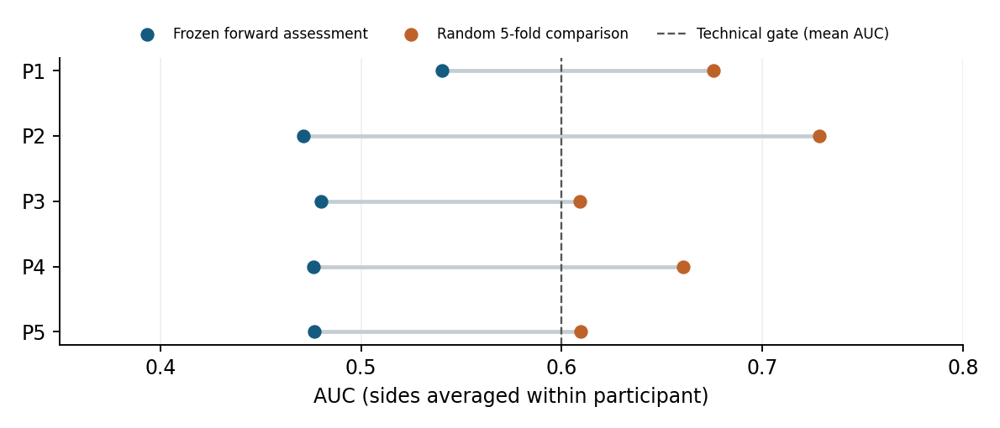

# Biomedical AI Agent Benchmarking

A case study and reproducible reference implementation for evaluating AI agents on biomedical analytics tasks. The work combines realistic task design, statistical reference solutions, competing baselines, structured rubrics, and evidence-based review of model responses.

[Portfolio case study](https://pmeraga.github.io/portfolio/biomedical-agent-benchmark.html) · [Task prompt](task/prompt.txt) · [Workflow specification](task/workflow_charter.md) · [Rubric](task/rubric.json) · [Evaluation record](docs/evaluation.md)

## What I built

- Developed and revised biomedical decision tasks spanning oncology study feasibility, clinical prediction, competing risks, trial planning, and longitudinal biomarker validation.
- Expanded a supplied 26,000-study registry with API data, reconciled study identifiers and clinical definitions, and audited provenance and file necessity.
- Built runnable statistical reference analyses and plausible competing analyses to check whether a task tests analytical judgment rather than data cleaning alone.
- Reviewed paired agent responses against task requirements, distinguishing substantive statistical mistakes from justified differences in modeling, resampling, or presentation.
- Audited rubric/version mismatches, tracked attempts and evidence, and packaged deterministic offline analyses with source hashes and sensitivity checks.

This public deliverable focuses on a pain-decoder validation task supported by an explicitly CC0 source. It includes code, the task specification, the proposed rubric, aggregate reference results, and the checks needed to reproduce them. The analysis and documentation were developed with AI-assisted coding and independent numerical cross-checks.

## A concrete result: validation design changes the decision

A personalized single-band pain decoder is calibrated before each participant's clinical handover and then frozen during later monitoring. The technical qualification policy requires mean AUC of at least 0.60, with sides averaged within each participant and five participants weighted equally.

| Assessment | Mean AUC | Technical decision |
| --- | ---: | --- |
| Frozen calibration, later monitoring | 0.4891 | Return for recalibration and prospective validation |
| Shuffled five-fold comparison across the observed history | 0.6566 | Would qualify |
| The same shuffled-fold predictions, restricted to monitoring observations | 0.5053 | Does not qualify |

The last control matters: the contrast includes a substantial shift in the validation population and clinical phase. It cannot be attributed solely to feature-selection leakage or temporal autocorrelation. The shuffled comparator fits band selection and LDA inside each training fold; even a careful cross-validation implementation can answer the wrong deployment question.



The release contains nine device-side files from five people, not nine independent participants. The monitoring assessment has 715 distinct extreme-state clinical surveys, including only three high-pain surveys each for two participants. Many time-block bootstrap draws lose a required class. Reporting only the finite draws as an ordinary confidence interval would hide that lack of support.

## Agent evaluation evidence

An earlier pair of platform evaluations was **reported at 48% and 92%**, with neither receiving full marks in that reported evaluation. These are reported historical results, not independently reproduced grades; the exact historical prompt/rubric association could not be verified. They are not a benchmark-wide accuracy estimate or evidence that every run scored below 100%.

For the decoder task published here, both reviewed response narratives recovered the approximately 0.489 monitoring AUC and correctly recommended recalibration. They also addressed temporal validation, bilateral dependence, sparse states, and uncertainty. Their generated PDF/Python files were not supplied for independent execution, and no numerical platform grades were available for that pair. The evaluation record credits these successful analyses rather than treating harmless numerical differences as failures.

## Reproduce the reference

```bash
cd projects/biomedical-agent-benchmark
python3 -m venv .venv
source .venv/bin/activate
python -m pip install -r requirements.txt

# Obtain the source from its public Dryad page, then verify the local archive.
python src/verify_source.py /path/to/Shirvalkar_sEEGCLDBS_2026.zip

# The replay reads the original archive directly; no network calls are made.
python src/decoder_analysis.py /path/to/Shirvalkar_sEEGCLDBS_2026.zip results
python src/check_results.py results/analysis.json
python -m unittest discover -s tests -v
```

The default replay includes 2,000 block-resampling draws per block length. Use `--bootstrap-reps 0` for the primary result and sensitivity checks without resampling. Outputs include aggregate analysis JSON, device-level evidence, source hashes, and per-side prediction tables. Generated outputs are ignored by Git; only aggregate reference evidence is committed here.

## Skills demonstrated

| Area | Skills applied | Evidence |
| --- | --- | --- |
| AI agent evaluation | Benchmark and task design; realistic stakeholder prompts; paired-run review; error taxonomy; scoring-rubric design; criterion versioning; iteration tracking; distinguishing reasoning failures from formatting errors | [Task](task/), [evaluation record](docs/evaluation.md) |
| Experimental reasoning | Estimand definition; deployment-matched validation; competing-baseline construction; leakage prevention; calibration/monitoring separation; model-selection bias; temporal and population shift | [Reference implementation](src/decoder_analysis.py) |
| Biostatistics | Competing risks and informative observation; clinical heterogeneity; trial power/variance uncertainty; hierarchical prediction; cluster-aware resampling; sparse-event/class support; sensitivity analysis; clinical versus technical interpretation | [Methods and scope](docs/methods.md), [reference results](reference/) |
| Biomedical data engineering | ClinicalTrials.gov API ingestion; identifier reconciliation; clinical cohort/endpoint adjudication; longitudinal survey alignment; bilateral and duplicate-record reconciliation; HDF5/CSV processing | [Source verification](src/verify_source.py), [decoder replay](src/decoder_analysis.py) |
| Statistical computing | Python; NumPy; pandas; SciPy; scikit-learn; h5py; univariate LDA; ROC AUC and weighted rank statistics; block bootstraps; numerical cross-checking | [Code](src/), [tests](tests/) |
| Reproducible research | Offline CLI workflows; source checksums; frozen candidate specifications; deterministic seeds; exact input accounting; reference outputs; dependency isolation; version control | [Workflow charter](task/workflow_charter.md), [result checks](src/check_results.py) |
| Research communication | Decision-first clinical memos; evidence tables; Matplotlib figures; PDF generation and visual QA with ReportLab/Poppler; supplementary answer design; clear uncertainty and limitation statements | [Case study](https://pmeraga.github.io/portfolio/biomedical-agent-benchmark.html), [figure](figures/) |
| Research governance | Data licensing and provenance review; source attribution; transparent metadata cleanup; rubric consistency audits; calibrated performance claims; privacy-conscious public packaging | [Data provenance](DATA_PROVENANCE.md), [evaluation record](docs/evaluation.md) |

The broader biostatistical methods above describe the project series; this repository's executable demonstration is the longitudinal decoder replay. They do not imply that one script implements every earlier candidate.

## Source and scope

[Shirvalkar et al., Dryad DOI 10.5061/dryad.b2rbnzsvr](https://doi.org/10.5061/dryad.b2rbnzsvr), published October 27, 2026; data released under CC0 1.0. The terminal off-stimulation features support the defined research replay, not an implanted-device certification, causal analgesic claim, or estimate for new patients. A clock alignment convention and sensitivity envelope are explicit in the task. Missing follow-up remains unobserved. See [provenance](DATA_PROVENANCE.md) and [methods](docs/methods.md).
